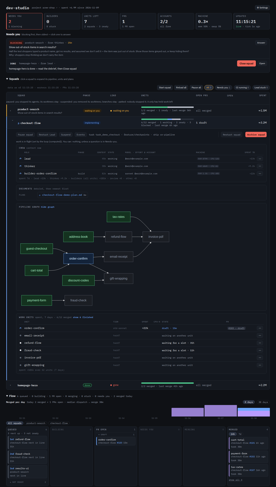

# dev-studio

## What it is

dev-studio runs many topics of work in parallel on your host while you stay in
control. It runs on Orca. You get a place to think, one board that shows every
topic's true state, and questions that reach you instead of getting buried.

- A **squad** is a small team of agents on one topic: a Lead, a Thinker, and
  Builders, Reviewers and Testers as needed. You talk to its Lead and plan with
  its Thinker; you never touch its Builders.
- Your **Studio** is one Claude session per project. You brainstorm, plan, and
  start, suspend and close squads from it.
- A **loop** daemon does the acting. It watches Orca and GitHub, starts and
  restarts members, picks models and accounts, delivers messages and merges PRs,
  and writes everything the board shows. How it works is in
  [docs/loop.md](docs/loop.md).



*The board on a demo project (all data fake).* [See the whole board](docs/img/board-full.png).

## Install

On the Orca host you need `git`, `jq`, Claude Code, the `orca` CLI with a
reachable runtime, and [Bun](https://bun.sh). `orca account list` must show at
least one Claude login (add one with `orca account add`), and Orca's "Nested
worker depth" must be 2 or more, or a squad's workers fail to start.

```sh
git clone https://github.com/OWNER/dev-studio.git
cd dev-studio
bin/host/install.sh --skills
```

This links `~/.dev-studio` to the checkout, puts the `/ds-*` commands in
`~/.claude/commands`, installs the skills the squad members use, and starts the
loop with a per-minute watchdog that restarts it. `bin/host/install.sh --check`
changes nothing and fails when the loop or its watchdog is missing. Prerequisites
and fixes → [docs/USAGE.md](docs/USAGE.md).

## Your first squad

1. In a shell on the host: `~/.dev-studio/bin/host/up.sh <git-url>` (or
   `/ds-up <git-url>` in any Claude session). It adds the project and brings up
   its Studio.
2. Open the `ds-<project>-studio` worktree in the Orca UI.
3. In the Studio: `/ds-start-squad <topic>`. The loop creates the squad.
4. Talk the topic through with the squad's Thinker, then approve its plan.
   Nothing builds before you approve.
5. Watch it on the board, and answer questions there or in the terminal.

Each project picks how finished work lands (`ce-pipeline`, `no-mistakes`,
`direct-PR` or `local-only`) in [docs/settings.md](docs/settings.md).

## The board

`/ds-board` in the Studio prints it; `~/.dev-studio/bin/board/board.sh <project>
--serve` serves the web board. It reads the loop's database and shows:

- every squad's phase, pipeline, units, PRs and spend;
- **Needs you**: the questions and alerts waiting on you, each with options and
  a recommendation;
- the accounts, their limits and resets, and the host's load;
- a banner when the host's dev-studio checkout is behind (`/ds-update`).

Writes from the web board (answers, settings, starting a squad) become requests
the loop carries out.

## Commands

| Command | Does |
|---|---|
| `/ds-up <git-url>` | Add a project and bring up its Studio |
| `/ds-start-squad <topic>` | Start a squad on a topic |
| `/ds-board` | Show the board |
| `/ds-q` | Answer a squad's open questions |
| `/ds-update` | Pull dev-studio and bring running squads up to date |

All commands → [docs/USAGE.md](docs/USAGE.md).

## Docs

- [docs/USAGE.md](docs/USAGE.md) — install and use, step by step.
- [docs/how-it-works.md](docs/how-it-works.md) — one topic end to end, inside a squad.
- [docs/loop.md](docs/loop.md) — the loop: what runs on its own, folder by folder.
- [docs/settings.md](docs/settings.md) — every setting in one place.
- [AGENTS.md](AGENTS.md) — the agent-facing map of the system.
- [conventions/](conventions/) — the rules each part follows.

## Licence

MIT. See [LICENSE](LICENSE). dev-studio runs on Orca, which is the only backend it supports today.

## Reporting a security issue

Report it privately through GitHub's security advisories: open the repository's **Security** tab and choose **Report a vulnerability**. Please do not open a public issue for it.
