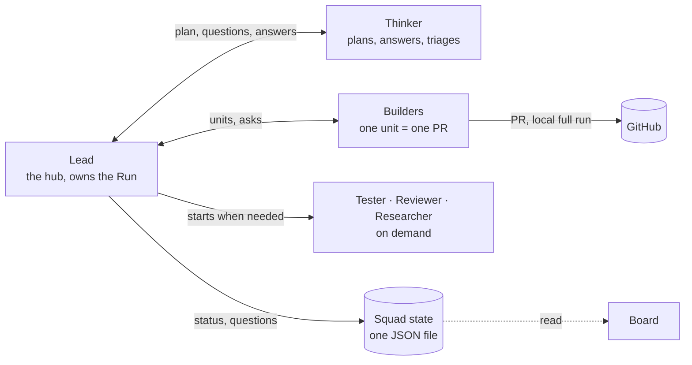
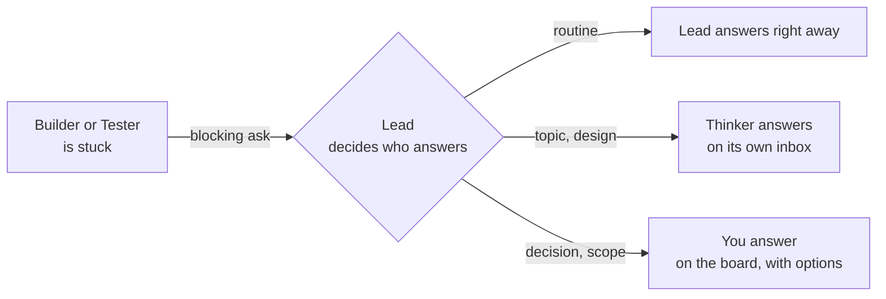
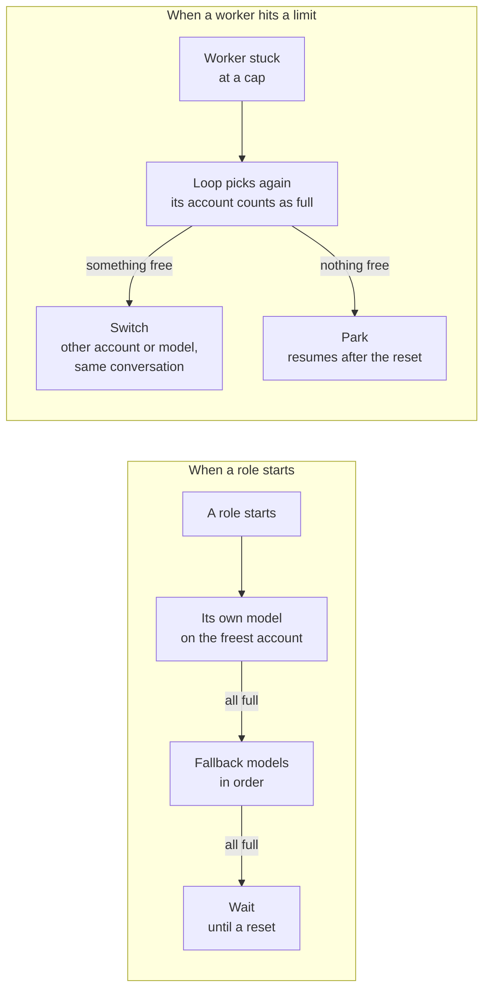

# How it works

The longer version of the [README](../README.md): one topic end to end, then
what is inside a squad. It is built as instruction-sets, conventions, and thin
bash helpers over the native `orca` CLI — not new infrastructure.

## A full run of one topic

| # | Step | Who | Board shows |
|---|---|---|---|
| 1 | **Start** — `/ds-start-squad <topic>` in the Studio creates the squad's Run, a Lead and a Thinker, each in its own worktree. | **you** | running |
| 2 | **Brainstorm and plan** — you talk the topic through with the Thinker; it turns it into a plan of units (one PR each) with their build order, and scores the topic and each unit (which decides the models). | **you** + Thinker | running |
| 3 | **Approve the plan** — on the board and in the Thinker's terminal, or visually in Lavish. Approve, or ask for changes and go back to 2. Nothing is built before this. | **you** | waiting on you |
| 4 | **Build** — the Lead starts Builders, in parallel where the order allows, each on the freest account that has its model. Each Builder implements with tests, simplifies, gets an independent code review, opens the PR. The loop then reads the PR and pokes the Builder about anything not merge-ready, until every required check is green. | Lead + Builders | running |
| 5 | **Test and fix** — the Thinker decides whether the change is worth testing (borderline: it asks you — auto / by hand / skip). A Tester runs its scenarios. Blocking bugs become fix units (at most two fix → retest rounds, then it comes to you); minor bugs become held follow-up units. | Thinker + Tester | running |
| 6 | **Done and close** — the Lead pings you. You triage the held follow-ups (file / fix now / drop), then `/ds-close-squad`: worktrees removed, squad archived off the board, unmerged branches kept. | **you** | done |

At any point you can suspend a squad (frees its terminal slots, keeps state, branches and
conversations) and resume it later, or restart a role that went wrong. An `lfg` squad skips
step 3: it decides, logs the assumption and carries on.

Details in `../roles/thinker.md`, `../roles/tester.md`, and `../conventions/squad-types.md`.

## Inside a squad

- **Lead** — the hub. It owns the squad's Orca Run, so every blocking question lands with
  it, and it is the only role that writes the squad's state file the board reads. You never
  touch its Builders; the roles never message each other directly.
- **Thinker** — plans the topic, answers forwarded questions on its own inbox, decides what
  to test and which bugs block.
- **Builder** — one per unit; builds *and* ships it end to end. One unit = one PR.
- **On demand** — a **Tester** runs the Thinker's scenarios and files bugs (it never
  fixes), a **Reviewer** adds a pass on a risky PR, a **Researcher** digs into a question.

Each role runs on its own configurable model — see [Models and accounts](#models-and-accounts).

## How a question finds its answer

A stuck Builder or Tester asks the **Lead**, which decides who answers:

- **routine** → the Lead answers right away;
- **topic or design** → forwarded to the **Thinker's** inbox;
- **a real decision, a scope change, or anything stored for later** → **you**, on the board,
  with options and a recommendation.

Every answer goes back through the Lead. Messages don't interrupt anyone: a message is a row
in `loop.db`, and the loop pokes the receiver once per batch when it is idle (for a squad the
loop does not run, Orca's push-on-idle and a rewake hook that peeks every 20 s do the same). The
Lead also checks on a Builder that sits idle for 15 minutes without finishing its unit.

| The squad decides | Always goes to you |
|---|---|
| Routine questions with one clear answer (Lead) | Approving the plan before any build starts |
| Topic and design questions (Thinker) | Scope changes: growing or cutting the plan |
| Fixing bugs inside the squad's own work | Anything stored for later: held units, tickets, issues |
| Unit order and which units run in parallel | Whether a borderline change is worth testing |
| Up to two fix and retest rounds on blocking bugs | A blocking bug still open after two rounds |
| Nudging or restarting a stuck Builder | Closing the squad and triaging minor follow-ups |

## Models and accounts

Models are configuration, not code: `../conventions/roles.conf` holds the shared default (one
`name agent model spawn [effort] [fallbacks]` line per role, rationale in
`../conventions/models.md`), and `/ds-roles` writes a per-project override.

- **Per role.** Every role has its own model and an optional ordered list of fallback
  models. A cheaper supervision model for the Lead, a stronger one for the Thinker, and so on.
- **Hard topics get a deep planning step.** The Thinker scores each topic. A **hard** one
  (spans repos, new architecture or migration, security/auth/payments/deletion, more than
  four units, or ambiguous enough to plan two very different ways) gets one planning step on
  the `thinker-deep` model — a one-shot call, never a terminal. When unsure, it scores easy.
  Rules: `../conventions/thinker-routing.md`.
- **Units are tiered.** The Thinker tiers each unit `standard` or `hard`. In `ce-pipeline`
  mode a standard unit builds on the `builder-standard` model, a hard one on `builder`.
  When unsure the Thinker picks `standard`; the Lead moves a struggling unit up to `hard`. A hard
  unit's full review runs on `builder-review` (Opus), a standard unit's on `builder-review-standard`
  (Sonnet) — that review is what makes a cheaper build safe.
- **A built unit is babysat on a cheaper model.** Once a Builder's PR is open and the Builder
  sits idle with nothing waiting for it, the loop restarts it fresh in the same worktree on the
  `builder-<tier>-babysit` row (sonnet), with a prompt naming the unit, branch, PR and journal.
  The babysitter makes checks green, answers review threads, rebases, re-runs the review after
  each fix and runs `finish-unit.sh` at merge-ready. A Builder is babysat once per unit.
- **Accounts.** Every start (`spawn-squad`, `add-role`, via `../bin/ds pick`, the loop's picker) tries the
  role's own model on each account of its agent, the one resetting soonest with room first, then each fallback in
  order. An account is skipped when its session window or (for the top models) weekly cap is
  ≥95% used, or a limit is still running; unknown usage counts as free. Nothing free: a
  Builder's unit waits for the earliest reset, and `spawn-squad` refuses with the time.
- **Limits mid-run.** The loop notices a worker stuck at a cap, picks again with its account
  counted as full, and either **switches** it to another account or model (keeping its
  conversation) or **parks** it until the reset. It alerts you if the Studio itself runs out
  of credits.
- **Out of credits.** An account whose provider says billing failed (a 402, "out of credits") is
  held; while a member on it has nowhere else to go, Needs-you shows one card per account with
  the provider's notice and billing link: **Fixed** ends the hold, **Switch it off** turns the
  account off. The card clears itself when the hold ends or nobody is stuck; when everyone moved
  off, a note says where. The Accounts row reads `out of credits` with the link.
- **On the board.** One card per account with session and weekly usage bars and reset times;
  each crew row names its account and whether it runs on a fallback; per-worker token spend.

More accounts = more headroom: each `ds account add` on the host adds another login that
squads can use.

## The loop: what runs on its own

One Bun daemon, `bin/loop/main.ts`, runs every squad. Every few seconds it reads Orca, GitHub and
the project's files into `state/loop.db`, compares that with what was asked for, and acts on the
gap. Roles, scripts and the board never start or stop workers themselves: they write a row, and
the loop does it. It pokes a Builder when its PR changes, restarts a dead or limited worker on an
account with room, tells the Lead when a unit's prerequisites finish, and marks a unit done when
its PR merges. A watchdog (`bin/loop/loop.sh --ensure`, once a minute) brings it back if it
dies, and the board shows a banner while it is down.

How one tick works, what `loop.db` holds and how to find out why something is stuck are in
[`loop.md`](loop.md). The wake rules are in [`../conventions/wake.md`](../conventions/wake.md).

## The pieces

- **State** (`../conventions/state.md`) — each Lead writes its squad's status to disk, always, so the board is ground truth.
- **Escalation** (`../conventions/escalation.md`) — a squad question flows role → Lead, which answers it, asks the Thinker, or **pings you**; nothing gets buried.
- **Wake** (`../conventions/wake.md`) — the loop's poke, Orca's push-on-idle and an asyncRewake Stop hook wake each standing agent on an inbox message, in its own session. No clock, no heartbeat.
- **Loop** (`../bin/loop/main.ts`, [`loop.md`](loop.md), [above](#the-loop-what-runs-on-its-own)) — observes the studio, reconciles it with what was asked for and acts on the gap, with a watchdog to restore it.
- **Autonomy** (`../conventions/autonomy.md`) — checkpoints by default, `lfg` for fire-and-forget (decide, log the assumption, continue).
- **Journals** — the Lead, Thinker, Builders and Studio keep a journal (`../bin/role/journal.sh`); after a restart a session reads its pinned notes plus the latest decisions and picks up where it stopped.
- **Models and accounts** (`../conventions/models.md`, `../conventions/roles.conf`, `../conventions/thinker-routing.md`, `../conventions/plan-shape.md`) — per-role models with fallbacks, topic and unit scoring, account picking and limit handling (see above).
- **Notes** (`../conventions/learnings.md`) — every role start spec carries the command that prints that role's per-project notes (`../bin/role/notes.sh`) and the trigger to add one.
- **Shipping** (`../conventions/ship-modes.md`) — per project: `ce-pipeline` (default; the Builder ships via `ce-work` → `ce-simplify-code` → `review-unit.sh` (`ce-code-review`) → PR; the loop then pokes it until the PR is merge-ready), `no-mistakes`, `direct-PR`, or `local-only`. No mode skips the repo's own CI, branch protection or required checks.
- **Sequencing** (`../conventions/sequencing.md`) — the Lead orders its units from the Thinker's plan.
- **Backend** (`../conventions/backend.md`) — all `orca` access is behind one adapter; swappable via `BACKEND=`.
- **Orca notes** (`orca-notes.md`) — durable facts about the Orca backend (the long-poll cap, nested-worker-depth, sender-terminal requirement) + the Orca-source improvement ideas we considered. Read before debugging a runtime stall. Recovery runbook in `ds-revive-notes.md`; the 2026-10-09 recovery retrospective + follow-up fixes (path-based id resolution, etc.) in `incident-2026-10-09-orca-recovery.md`.
- **Learnings** (`../conventions/learnings.md`) — compound via `ce-compound` into each project's `docs/solutions/` *and* this system's own, so both the projects and the orchestrator get smarter.

## Demo board

The README picture (`img/board.png`, and `img/board-full.png` behind its link) is taken from a fake project, never from a live board.
The board reads only `$DS_STATE_ROOT/loop.db`, so `../scripts/demo-board.sh` makes a temp state
root, seeds a fake `loop.db` in it (the `acme-shop` project: three squads, a blocking question,
accounts, machine figures, a brief and events; built the way `tests/board.sh` builds its boards)
and runs the real board against it. It copies no board code, never touches the live state or
real Orca, and removes the temp dir on exit.

- `scripts/demo-board.sh [port]` serves it on `http://127.0.0.1:8791/` (default port).
- `scripts/demo-board.sh --json` prints the board JSON once; `--events` prints the event log's rows.
- To re-take the pictures run `scripts/demo-board-shot.sh` (or `scripts/demo-board.sh --shot <dir>`). It
  serves the demo on a free port, checks in the page that each section (squads, flow, accounts, machine,
  briefs, events) has content and no "Loop down" banner shows, then writes `board.png` (the top, down to the
  Flow chart) and `board-full.png` (the whole page, `checkout-flow` expanded) at 1440 px wide, and stops what
  it started. It needs Node and a headless Chrome, so it is not in `tests/ci.sh`. While it serves,
  `scripts/demo-board-refresh.ts` keeps the temp db's heartbeat fresh, so the board never reads as down.
- `tests/demo-board.sh` keeps it working: it fails when a section (header tiles, Needs you,
  Squads, Flow, Accounts, Machine, Briefs, Event log) has no rows, and checks the run leaves
  the live state and a running board alone.
