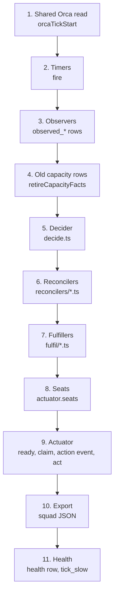
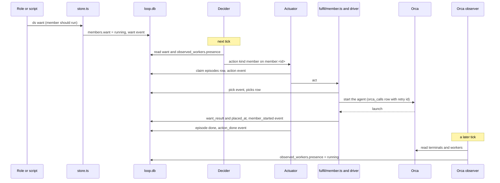
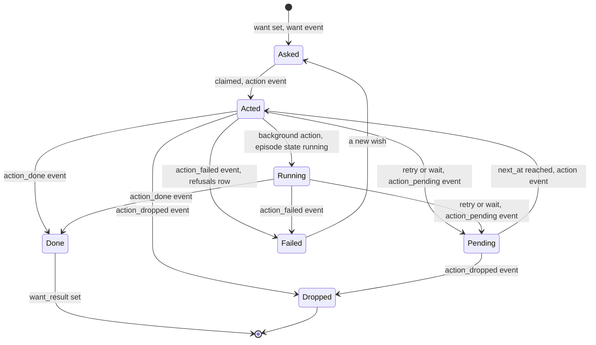
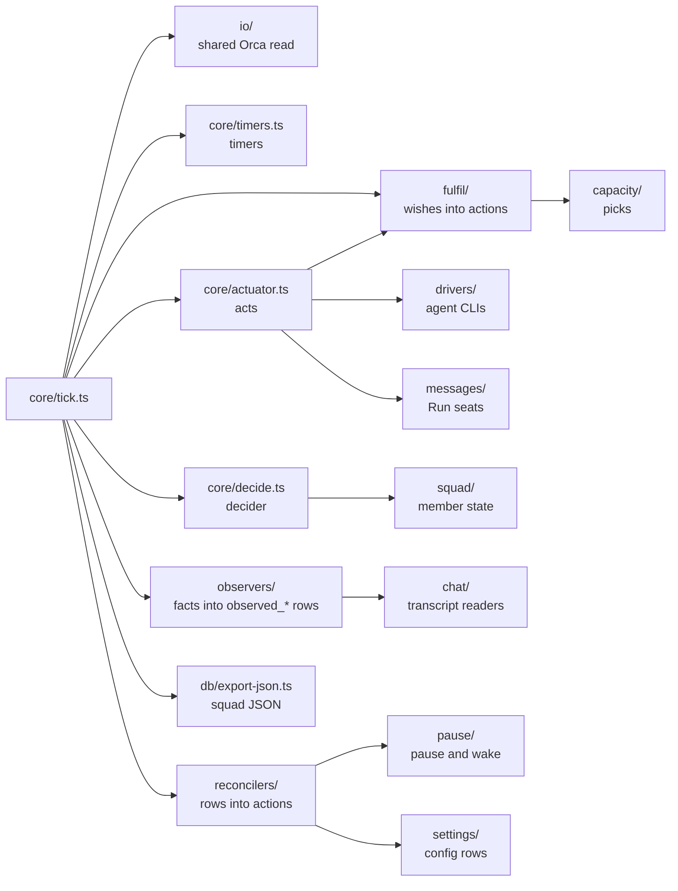

# The loop

The loop is the one process that runs dev-studio's squads. It is a Bun daemon,
`bin/loop/main.ts`, one per state root. It wakes every few seconds, looks at
what is true, compares that with what was asked for, and acts on the gap.

Everything it knows sits in one SQLite file, `state/loop.db`. Roles, scripts and
the board never talk to Orca themselves. They write a row, and the loop does the
rest on its next turn.

`bin/loop/loop.sh` starts, checks and stops it. A cron line runs
`bin/loop/loop.sh --ensure` every minute, so a loop that died or stalled comes
back by itself.

This page explains one turn (a **tick**), what `loop.db` holds, why roles only
write rows, how to find out why something is stuck, and which folder holds what.

## One tick, step by step

A tick runs every `DS_LOOP_TICK_S` seconds (5 by default). The code is
`Loop.tick()` in `bin/loop/core/tick.ts`. It does these steps, in this order:

1. **Shared Orca read.** The tick opens one cache for Orca reads, so every step
   that asks Orca the same thing in this tick shares one answer
   (`bin/backend/orca-cache.ts`, `bin/loop/io/run-keep.ts`).
2. **Timers.** Every row in the `timers` table whose `due_at` has passed fires.
   It is removed and leaves one `timer` event (`bin/loop/core/timers.ts`).
3. **Observers.** Each observer whose interval (`every`) has run out reads the
   world and writes what it saw into `observed_*` rows: Orca's terminals and
   workers, GitHub's PRs, the host's load, the transcripts. Observers only record.
   They never act.
4. **Old capacity rows.** `retireCapacityFacts` clears rows an older design left
   behind (`bin/loop/fulfil/pending.ts`).
5. **Decider.** `bin/loop/core/decide.ts` runs first among the deciding steps.
   For each member it compares the wish (`members.want`) with what the observers
   just saw (`observed_workers.presence`), and gives at most one action: start,
   stop, close, a reload message, and so on.
6. **Reconcilers.** Each file in `bin/loop/reconcilers/` reads rows and returns
   actions. They repair drift between the rows and reality.
7. **Fulfillers.** Each file in `bin/loop/fulfil/` turns open wishes and
   requests into actions, and also knows how to carry out its own action kind.
8. **Seats.** For each project the actuator makes sure the loop holds each
   squad's Run, so it can start workers in it (`bin/loop/messages/coordinator.ts`).
9. **Actuator.** For each new action: skip it if the same episode is already
   claimed, ask `ready()` whether it may go now, claim it in `episodes`, write one
   `action` event, then `act()`. Only this step changes Orca or the files
   (`bin/loop/core/actuator.ts`).
10. **Export.** Every squad whose rows changed gets its JSON snapshot rewritten in
    `state/<project>/squads/<topic>.json` (`bin/loop/db/export-json.ts`).
11. **Health.** The `health` row gets `tick_at`, `tick_no`, `tick_ms` and
    `progress_at`. A tick that took longer than its interval writes a `tick_slow`
    event, at most every 10 minutes, naming the slowest steps.

A step that throws does not stop the tick. It leaves a `plugin_error` event and
the next step runs. The health row is written even then.

Steps 3, 5, 6 and 7 are plugins. A unit adds one by dropping a file in
`bin/loop/observers/`, `bin/loop/reconcilers/` or `bin/loop/fulfil/`. Nothing
lists them: `bin/loop/core/plugins.ts` loads each folder in filename order, with
the decider in front. A plugin runs once per project, or once per tick when its
`scope` is `host`.

Actions are kept apart by an **episode**. An action names a project, a subject
(such as `member:899` or `req:11706`), a kind (such as `member` or `answer`) and
an episode key. The claim is one `episodes` row per project, subject and kind
`action:<kind>`. The same episode key again is a no-op. A new key replaces the
old claim. So a reconciler can return the same action every tick and the loop
still acts once.

## What loop.db holds

`state/loop.db` is the truth. The squad JSON files are snapshots the loop writes
out of it. The schema is built by the numbered files in `bin/loop/migrations/`,
starting with `bin/loop/migrations/0001-init.sql`. The tables fall into four
groups.

**What was asked for.**

- `squads` and `members`: one row per squad and per member. The `want` column
  is the wish (`running`, `stopped`, `gone` for a member). `want_by` and
  `want_at` say who asked and when. `want_result` is the loop's answer: empty
  until acted on, then the launch, `done: …` or `failed: …`. `restart_at`,
  `reload_at` and `clear_at` hold one-time wishes.
- `units`: each unit of a squad's plan, with its status and PR.
- `requests`: one-off asks (poke, answer, chat, a settings edit, a merge). A row
  has a `kind`, a JSON `payload`, a `key` so asking twice leaves one row, and
  `done_at` and `result` once the loop has handled it.
- `messages`: role-to-role mail, with `sending_at`, `delivered_at`, `read_at` and
  `reply_to`.
- `overrides`: pins the operator set on a member, squad, role or project.
- `config` and `config_history`: every project's settings and each change to
  them (`docs/settings.md`).

**What was seen.** The `observed_*` tables. Observers write them and nothing
else does. The ones you read most:

- `observed_workers`: each member's agent as Orca shows it. `presence` is
  `running`, `none` or `unknown`; the decider reads a member it placed that no
  read has seen yet as `starting`. `live_model` is the model it really
  runs, which can differ from what `members.model` says.
- `observed_terminals` and `observed_worktrees`: Orca's terminals and worktrees.
- `observed_prs` and `observed_github`: PR state, and the GitHub budget
  (`remaining`, `rate_limit`, `reset_at` on the row with repo `''`).
- `observed_accounts` and `observed_limited`: account usage and who sits on a
  limit.
- `observed_transcripts` and `observed_chat`: where each member's transcript is,
  and its recent turns for the board's chat panel.

**What the loop is doing.**

- `episodes`: the claim for each action, and its state (see
  [When something looks stuck](#when-something-looks-stuck)). `next_at` is when a
  waiting action is tried again. `action` holds the action while it waits.
  `result` holds what it ended with.
- `orca_calls`: every Orca change the loop made, with its `retry_id`. A call
  retried after a crash reuses the id, so Orca does it once.
- `refusals`: an action Orca refused, with the text, a count, and whether the
  refusal is `transient` or `permanent`.
- `picks`: which agent, model and account each start got, and why.
- `deliveries`: text the loop typed into a terminal, and whether a turn started.
- `coordinators`: the loop's own pane in each squad's Run.
- `orca_runs`, `orca_coordinators`, `orca_dispatches`, `orca_workers`,
  `orca_pauses`: a copy of each Orca-only value the tables above hold (a
  squad's Run and task, its coordinator, every dispatch, each worker's
  current dispatch, the dispatch a pause went out under). Triggers fill them
  on every write; nothing reads them yet.
- `timers`: due times that fire at the start of a tick.

**What happened.**

- `events`: one row per thing the loop did or saw, with `at`, `project`,
  `squad`, `member`, `kind` and a JSON `payload`. The one thing that deletes them
  is `ds remove-project`, which moves a removed project's rows, these and those in
  its other tables, into an archive under `state/.removed/`. This is the first
  place to look when something went wrong.
- `health`: one row, the loop's pid and its last tick (`tick_at`, `tick_no`,
  `tick_ms`, `progress_at`).

## Roles write rows, the loop acts

Only the loop talks to Orca. A Lead, a script or the board never starts or stops
a worker. It writes what it wants, and the loop makes it happen. There are three
ways to write, all through `bin/loop/core/store.ts`:

- **A fact**, such as "unit 3 has PR 600". It is written at once with an event,
  so the writer reads it back straight away.
- **A wish**, such as "this member should run". It is the member or squad row
  itself, with `want` set. `bin/ds want` and `bin/commands/add-role.sh` write
  it. Asking twice leaves one row.
- **A request**, such as "poke this member" or "merge this PR". It is a
  `requests` row the loop handles once and marks done. `bin/ds nudge` and
  the board's buttons write these.

Why this way:

- **One actor decides.** Before the loop, scripts and agents each called Orca
  and could undo each other. Now one process reads one store and acts, so the
  outcome does not depend on who ran first.
- **Nothing is lost in a crash.** A wish is a row. If the loop dies mid-step, the
  row is still there on the next tick, and `orca_calls` keeps a retried call from
  happening twice.
- **Everything leaves a trace.** Every wish, action and outcome is an event, so
  "why did this happen" has an answer in the database.
- **The wait is short.** A wish waits at most one tick, a few seconds.

Reconcilers change one column under a condition (`setIf`), never a whole row. So
a fact a role writes between the observers and the actuator is never overwritten.

Here is the path of one wish, a member that should run:

If there is no room for the start (no free start slot, no account with room),
the decider gives no action and the wish waits as it is. The next tick looks
again.

## When something looks stuck

Four commands show what the loop knows. All read `loop.db` and change nothing.

- `bin/loop/loop.sh --status` says whether the loop runs and prints its health
  row. It exits 3 when the loop is not running. If `tick_at` is old, the loop is
  stalled, and the cron watchdog restarts it within a minute.
- `bin/ds health` prints the health row alone: `pid`, `tick_at`, `tick_no`,
  `tick_ms`, `progress_at`.
- `bin/ds events` prints events, oldest first. Narrow it with `--project`,
  `--squad`, `--kind`, `--since <event id>` and `--limit`. `--last` prints only
  the newest one. Start here.
- `bin/ds observed <source>` prints one `observed_<source>` table, for example
  `bin/ds observed workers`. Run it with no source to list the tables. It shows
  what the loop believes is true, which is what it acts on.

`bin/ds members <project> <squad>` adds each member's effective state and its
pending one-time wishes.

### What an episode tells you

Every action the loop takes has one row in `episodes`. Its `subject` says what
it is about (`member:<id>`, `req:<id>`, a PR). Its `kind` is `action:<kind>`. Its
`episode_key` says which ask this is: a new restart or a new request gets a new
key. Its `state` says where the action stands.

So when a member will not start, find its `action:member` row. The state tells
you whether the loop never tried, is trying, is waiting to retry, or gave up. The
events with that subject tell you why.

A wish moves through these states. Each one shows in a column or an event:

- **Asked.** `members.want` is set and `want_result` is empty. The last event
  for the member is `want` (or `wish` for a restart, reload or clear). If it
  stays here, the decider sees no reason to act or no room to act: check
  `observed_workers.presence` and the latest `pick` event.
- **Acted.** The episode state is `acted`, and an `action` event carries the
  whole action.
- **Running.** The episode state is `running`. A slow action (a merge, a
  cleanup) runs in the background, up to `DS_LOOP_BG_SLOTS` at once.
- **Pending.** The episode state is `pending` and `next_at` says when it goes
  again. An `action_pending` event gives the reason: a failed send, "no free start
  slot", a pause, an agent still busy. When the decider already sees there is no
  room, it gives no action at all and the wish stays Asked. A start that finds
  its slot gone after it was claimed waits here.
- **Done.** The episode state is `done` and an `action_done` event was written.
  For a start, `want_result` holds the launch and a `member_started` event was
  written. For a close, `want_result` starts with `done:` and a `wish_done` event
  was written.
- **Dropped.** The episode state is `dropped` and an `action_dropped` event gives
  why: the episode ended, the member is paused for good, the action went stale.
- **Failed.** The episode state is `failed` and an `action_failed` event was
  written. Orca's answer is in `refusals`. A start that failed sets `want_result`
  to `failed: …` with a `member_start_failed` event, and a squad start that gave
  up leaves `wish_given_up`. A new wish tries again.

### Example: a merge-ready PR does not merge

**What the operator saw.** On 2026-11-17 two merge-ready PRs (#595 and #597)
stayed open. The merge kept failing with "API rate limit already exceeded",
although the GitHub budget had room.

**What showed the cause.** The merge's events in `bin/ds events` showed every try
failing on a rate limit, while `bin/ds observed github` showed `remaining` far
from zero. Running the loop's own `gh pr merge` line with `GH_DEBUG=api` showed gh
answering from its HTTP cache, and
`grep -l 'rate limit already exceeded' -r ~/.cache/gh` found the cached reply.

**Where it was.** Not in `loop.db`. gh had stored GitHub's rate-limit reply to
one of its own lookups in `~/.cache/gh`, and served it again on every merge for a
day.

**The fix.** U290 (PR #600). When a merge is refused for a rate limit while the
budget still has room, `bin/loop/fulfil/merge.ts` clears gh's cache, writes a
`gh_cache_cleared` event and a "gh cache cleared" alert, and tries once more.
When the budget is really used up, it waits for GitHub's reset
(`bin/loop/io/github-budget.ts`).

### Example: a healthy role restarts out of nowhere

**What the operator saw.** On 2026-11-06, right after an update, a healthy
Thinker restarted. Nobody had asked for it that day.

**What showed the cause.** `bin/ds events --squad <topic> --since <id>` showed the
chain. A `want` event from the day before (a Lead's restart, by
`restart-role`), then `action`, `pick` and `action_pending`: the restart had
waited for an account with room. A day later, after the update, came a new
`action` and an `action_done`.

**Where it was.** The `action_pending` episode. The update removed the timer that
had held it back, so the next tick found room and carried out a restart that was
no longer wanted.

**The fix.** U128 (PR #309). A held restart is dropped when the member was placed
after the restart was asked (`placed_at` later than `restart_at`). Today that
rule is in `pendingWishes` in `bin/loop/core/store.ts`.

### Example: a role is stopped every few minutes

**What the operator saw.** On 2026-11-07 a Thinker was killed about every 15
minutes, 42 times in 7 bursts.

**What showed the cause.** `bin/ds events --kind action_failed` showed the same
action again and again: "back from fallback: rung 3 -> 1". Each burst matched a
terminal death. `bin/ds members` showed the member row still on Codex, while the
session in the terminal was Claude.

**Where it was.** `members.agent` and `members.model` were stale. The fallback
step of that time read them, thought the role ran on a fallback model, stopped
the worker to move it back, and then the new start was refused. Next round, the
same again.

**The fix.** U149 records the model a member really runs in
`observed_workers.live_model`. U152 and U154 make the decider and the model
switches compare with that live value (`bin/loop/core/decide.ts`,
`bin/loop/capacity/switches.ts`). A move back also happens at most once per
`fallback_return_min`, and only when a start slot is free and the new pick lands
higher.

### Example: closing a squad never finishes

**What the operator saw.** On 2026-11-12 squads that were being closed stayed on
the board. Their members never went away.

**What showed the cause.** `bin/ds observed workers` showed the members with
presence `running`, although their agents had stopped. Their rows still carried
an old dispatch marked `dispatched`, whose Run had last been read a day before (`dispatch_seen_at`). Other members read `unknown` and stayed so.

**Where it was.** `observed_workers`. A stale dispatch kept presence at
`running`, so the decider kept asking for a stop and never for the remove. A
member read as `unknown` got no act at all.

**The fix.** U231 (PR #419). `bin/loop/squad/close-drift.ts` clears a stale
dispatch on a member that is being closed, with a `member_drift_cleared` event,
and tries a stop that did not take again, up to three times.

**A removal skipped as stale** (archive-stuck-worktrees U1). After the stop, Orca
can list the stopped agent's dispatch as live for about a minute, so `fulfil/close.ts`
drops the remove as `stale: presence running` (its drop result names why: `view stopped`,
`presence running` or `no worktree`). The claim never renews a dropped episode, so
`removeRetry` in `close-drift.ts` gives the next try a new episode, `<episode>:retry<n>`:
the first `DISPATCH_READ_MIN` + `WALK_MIN` (6 min) after the drop, then double the
wait each time, at most 30 min, with no cap on tries. From the third stale drop on,
while the squad is wanted gone, one Needs-you card `Archive slow: <topic>` (kind
`archive_slow`, option Seen) names the worktree, the tries, the last reason and the
next try; `alertGone` clears it once the member has no worktree or the squad is no
longer closing. `tests/loop/close-remove-retry.test.ts`.

## The folders

Everything the loop runs lives under `bin/loop/`. The tick reaches into the
folders in this order:

### main.ts and loop.sh

`bin/loop/main.ts` is the daemon: it opens `loop.db` (the store applies any
migration not yet run), loads the plugins and ticks forever. `bin/loop/loop.sh` is its front door
(`--ensure`, `--status`, `--stop`); the work is in `bin/commands/loop-ts.ts`.
`systemd/ds-loop.service` runs the daemon on the host.

`main.ts --role side` is the loop of a side host (default `main`). It loads only
the plugins `bin/loop/core/side-plugins.ts` names: observers of that
host (processes, transcripts and rollouts, chat, the backend contract, reviews,
exposed URLs, cleanup, disk usage, worktrees), and writes their rows into its own
`loop.db`. Two reconcilers run only there (U14): `side-push` pushes each Builder branch
that is ahead of its remote, and `side-fence` pushes and then closes the host's
own members once its link to main has been down for `host_grace_min` minutes;
`core/side-actuator.ts` acts on both, and a main loop never loads them. A plugin not on the list never runs there, so a new one is main-only
until someone names it. The decider is never loaded, and main's own steps are
left out: the old files' migration, the actuator, retiring capacity facts, the
squad JSON snapshots, and the rollback's export and board stop. Its projects are
the `projects` rows main sent down, not folders in the state root. It runs no
Studio, and of the `state` observer only the transcripts. Nothing starts it yet,
and it does not open the link yet.

### capacity/

Who runs on which model and account. `bin/loop/capacity/pick.ts` is the picker
behind `bin/ds pick`. `bin/loop/capacity/switches.ts` says when a member owes a
model switch (a limit, a fallback, a phase, a pin). `bin/loop/capacity/accounts.ts`
switches accounts on and off, `bin/loop/capacity/credits.ts` handles accounts out
of credits, `bin/loop/capacity/machine-level.ts` reads the host's load.

### chat/

Readers that turn a member's transcript into the turns the board's chat panel
shows. `bin/loop/chat/claude.ts` and `bin/loop/chat/codex.ts` read each agent's
transcript, `bin/loop/chat/screen.ts` falls back to the terminal screen, and
`bin/loop/chat/turns.ts` folds and trims the turns.

### core/

The loop's skeleton. `bin/loop/core/tick.ts` runs one tick,
`bin/loop/core/store.ts` is the only write path, `bin/loop/core/decide.ts` is the
decider, `bin/loop/core/actuator.ts` acts, and `bin/loop/core/plugins.ts` finds
the plugins. `bin/loop/core/kinds.ts` lists every wish, fact, request and action
kind with its payload shape. `bin/loop/core/timers.ts` holds the timers and
`bin/loop/core/redact.ts` blanks secrets before they are stored.

### db/

Moving state in and out of `loop.db`. `bin/loop/db/import-json.ts` imports the
old squad JSON once, `bin/loop/db/export-json.ts` writes the squad snapshots,
`bin/loop/db/seed.ts` seeds a project's wishes from what runs, and
`bin/loop/db/migrate-host.ts` imports each project's existing state once.
`bin/loop/db/project-rows.ts` copies one project's rows to an archive file and
then deletes them from `loop.db`: the big log tables (`events`, `orca_calls`,
`relayed`) in short batches, then the rest in one transaction that counts them
again first. The `remove-project` fulfiller, `bin/loop/fulfil/remove-project.ts`,
calls it.

### drivers/

One driver per agent CLI: how to start, resume and poke it, and how to answer
its menus. `bin/loop/drivers/types.ts` is the shared interface,
`bin/loop/drivers/claude.ts`, `bin/loop/drivers/codex.ts` and
`bin/loop/drivers/muse.ts` say what differs, and `bin/loop/drivers/index.ts` picks
one.

### fakes/

Stand-ins for Orca and GitHub that tests run the loop against:
`bin/loop/fakes/orca.ts` and `bin/loop/fakes/github.ts`. Nothing in a live loop
uses them.

### fulfil/

One file per action or request kind. Each turns open rows into actions and
carries its own kind out. `bin/loop/fulfil/member.ts` starts members,
`bin/loop/fulfil/close.ts` closes them, `bin/loop/fulfil/merge.ts` merges PRs,
`bin/loop/fulfil/poke.ts` types pokes, `bin/loop/fulfil/chat.ts` sends the
board's chat lines and `bin/loop/fulfil/pending.ts` retries waiting actions.

### io/

The loop's reads and calls to the outside world. `bin/loop/io/orca.ts` is the
loop's one way to Orca and to the shell, `bin/loop/io/run-keep.ts` keeps each Run's reads across
ticks, `bin/loop/io/github-budget.ts` paces GitHub calls, and
`bin/loop/io/refusals.ts` records what Orca refused.

### messages/

Mail between roles and the loop's place in each Run.
`bin/loop/messages/messages.ts` stores role-to-role messages,
`bin/loop/messages/relay.ts` turns Run mail into rows for the Lead,
`bin/loop/messages/coordinator.ts` keeps the loop's own pane in each Run, and
`bin/loop/messages/questions.ts` keeps a squad's questions for the operator.

### migrations/

The schema of `loop.db`, one numbered SQL file per change, applied in order on
start. `bin/loop/migrations/0001-init.sql` is the base. Never edit a file that
has shipped; add a new one.

### observers/

One file per source the loop watches; each writes `observed_*` rows and nothing
else. `bin/loop/observers/orca.ts` reads terminals and workers,
`bin/loop/observers/github.ts` reads PRs, `bin/loop/observers/machine.ts` the
host's load, `bin/loop/observers/chat.ts` the transcripts, and
`bin/loop/observers/update.ts` whether the checkout is behind.

### pause/

Pausing and waking members. `bin/loop/pause/pause.ts` holds the shared pause
state and guard, `bin/loop/pause/is-paused.ts` tells a script whether a member is
paused, `bin/loop/pause/stop-checkpoint.ts` asks a role for a journal checkpoint
before a planned restart, and `bin/loop/pause/wake.ts` is the one way the loop
pokes a member.

### reconcilers/

One file per kind of drift the loop repairs. `bin/loop/reconcilers/liveness.ts`
notices members that died, `bin/loop/reconcilers/lifecycle.ts` moves units and
PRs along, `bin/loop/reconcilers/limits.ts` records who sits on a usage limit,
`bin/loop/reconcilers/messages.ts` pokes members with unread mail, and
`bin/loop/reconcilers/record.ts` records what each member really runs.

### settings/

Each project's settings as `config` rows. `bin/loop/settings/settings.ts` is the
one writer, `bin/loop/settings/roster.ts` gives the roles a project runs,
`bin/loop/settings/skills.ts` the skills each role starts with, and
`bin/loop/settings/projects.ts` which projects the loop ticks.

### squad/

What a squad and its members are right now. `bin/loop/squad/member-state.ts`
gives a member's effective wish, `bin/loop/squad/member-ready.ts` says when the
loop may type into a terminal, `bin/loop/squad/close-drift.ts` unsticks closing
members, and `bin/loop/squad/studio.ts` adopts the project's Studio as a member.
